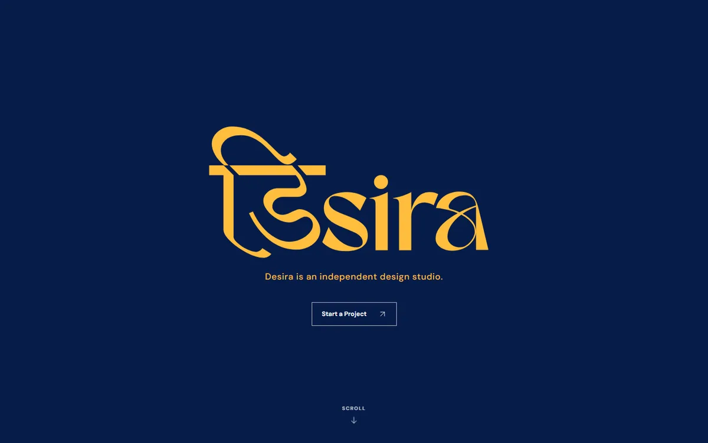
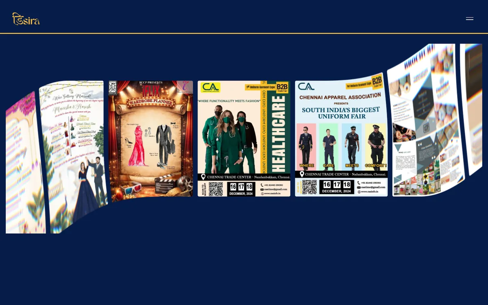

# Desira

**An independent graphic design studio in Chennai, brought to life on the web.** Desira's portfolio brings identities, posters, invitations, and event design together in one visual story.

[Visit the site](https://desiraft.com) · [Explore the work](https://desiraft.com/work/) · [Start a project](https://desiraft.com/contact/)



## A look inside

The home page moves from a quiet wordmark introduction into a WebGL poster carousel, selected projects, services, and a contact invitation. Project and service pages give each piece of work room to breathe.



## Highlights

- **Work first:** selected projects, image galleries, service pages, and a dedicated contact page.
- **Motion with purpose:** a floating navigation menu, scroll scenes, and a carousel with a fallback for browsers without WebGL.
- **Image conscious:** WebP posters and a loading treatment that clears as each photo becomes ready.
- **Search ready:** prerendered pages, page specific metadata, a Desira social preview, a favicon, structured data, `robots.txt`, and a sitemap.
- **Accessible by default:** semantic links, image descriptions, keyboard navigation, and reduced motion support.

## Built with

| Layer | Tools |
| --- | --- |
| Interface | React, Vite, CSS |
| Motion | GSAP, anime.js, OGL/WebGL |
| Content | Local JSON and image assets |
| SEO | Vite build plus a custom prerender script |

## Run locally

Install Node.js and npm, then run:

```sh
npm ci
npm run dev
```

Vite prints the local URL. To check a production build locally:

```sh
npm run build
npm run preview
```

Copy `.env.example` to `.env.local` and set `VITE_CONTACT_ENDPOINT` to the working contact form endpoint. No contact server is bundled with this repository. Without the endpoint, the form shows a setup message instead of sending a brief.

| Command | Purpose |
| --- | --- |
| `npm run dev` | Start the local development server |
| `npm run build` | Build and prerender the site into `dist/` |
| `npm run build:production` | Build and validate public SEO output using `SITE_URL` from the environment or `.env.local` |
| `npm run seo:check` | Validate the generated pages, sitemap, and robots rules |
| `npm run lint` | Run Oxlint |
| `npm run preview` | Serve the built site locally |

## Where to edit

| Path | What lives there |
| --- | --- |
| `src/data/` | Site copy, projects, services, navigation, and page metadata |
| `src/pages/` | Page composition and route specific content |
| `src/components/` | Layout, portfolio, form, and motion components |
| `src/styles/` | Brand tokens and responsive styling |
| `public/client-work/` and `public/posters/` | Artwork served by the site |
| `scripts/prerender.mjs` | Static HTML, social metadata, sitemap, and robots output |

Production uses **[desiraft.com](https://desiraft.com)** as its canonical domain. Vercel production builds generate indexable pages; previews stay `noindex`. Set `VITE_CONTACT_ENDPOINT` in the Vercel project's **Production** environment before deploying; `.env.local` stays on your machine. Run `npm run build:production` to verify the public metadata, sitemap, and robots rules locally.

## Credit

Website made by **[@daksh7kothari](https://github.com/daksh7kothari)** for Desira.

Adapted React Bits components are credited in [the third-party notices](THIRD_PARTY_NOTICES.txt).
